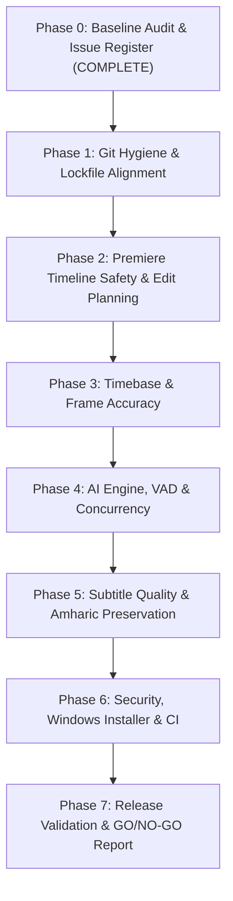

# YeneCut AI — Principal Engineering Remediation Audit & Baseline Report

**Audit Date:** 2026-11-18  
**Repository:** https://github.com/yemom/YeneCut  
**Auditor Roles:** Principal Software Engineer, Adobe Premiere Pro UXP Specialist, Python AI Engineer, Application Security Engineer, Windows Installer Engineer, QA Automation Architect  
**Active Remediation Branch:** `remediation/production-readiness`  
**Base Commit on `main`:** `8c2bc3c`  
**Comparative Reference Branch:** `fix/yenecut-production-readiness` (`0cdc15c`)  
**Target Environment:** Windows 11 / Adobe Premiere Pro 25.1.0+ (UXP API v5 / CC 2025)

---

## 1. Executive Summary & Audit Baseline

A rigorous forensic audit of the repository across all source directories, package manifests, build toolchains, Python modules, UXP typings, test suites, and documentation reveals that while significant preparatory code exists, the repository on `main` contains **multiple critical release blockers (P0)**, **severe architectural and safety risks (P0)**, and **massive repository bloat (P1)**.

### Baseline Test Execution Results (Executed on `main` / `remediation/production-readiness`)

| Test Suite / Baseline Check | Execution Command | Result | Details / Root Cause |
|---|---|---|---|
| **Python Pytest Suite** | `python -m pytest apps/ai-engine/tests -q` | **FAILED (Exit Code 1)** | `ModuleNotFoundError: No module named 'app'`. Package root is not in `sys.path` when running from workspace root. `apps/ai-engine/tests/test_regressions.py` is missing from `main` (only orphaned `.pyc` was tracked). |
| **Python Pytest (with `-o pythonpath=apps/ai-engine`)** | `python -m pytest -o pythonpath=apps/ai-engine apps/ai-engine/tests -q` | **PARTIAL PASS (10 passed)** | Only 10 tests run; regression suite missing; warnings about deprecated Starlette testclient `httpx`. |
| **Plugin TypeScript Typecheck** | `npm run typecheck:plugin` | **PASS (Exit Code 0)** | Zero TypeScript compiler errors (`tsc --noEmit`). |
| **Plugin Unit Tests (Vitest)** | `npm run test:plugin` | **PARTIAL PASS (1 file, 3 tests)** | Only `App.test.tsx` (3 tests) ran. `premiere.client.test.ts` missing on `main`. |
| **Plugin Build** | `npm --workspace apps/premiere-plugin run build` | **PASS (Exit Code 0)** | Vite v8.3.8 builds to `dist/`, validation script passes. |
| **Manifest Check** | `scripts/validate-plugin.ps1` | **PASS** | Validates `manifestVersion: 5`, host `premierepro` `minVersion: 25.1.0`. |
| **Git Hygiene Check** | `git ls-files` | **CRITICAL FAILURE** | **8,600+ tracked generated files** on `main`, including `node_modules/`, `__pycache__`, `.pyc`, and `.refact/` state. |

---

## 2. Comprehensive Issue Register

### P0 — Release Blockers & Timeline Safety Criticals

#### ISSUE-P0-01: Non-Existent UXP Method `editor.createRazorTrackAction` Invocation
- **Severity:** P0 (Runtime Crash in Adobe Premiere Pro)
- **Affected File:** `apps/premiere-plugin/src/premiere/timeline.service.ts` (lines 107–108)
- **Evidence:**
  ```ts
  actions.push(
    editor.createRazorTrackAction(mediaType, track.index, position, true, mediaType)
  );
  ```
  Inspection of installed `@adobe/premierepro` type definitions (`node_modules/@adobe/premierepro/src/premierepro.d.ts`, lines 3434–3532) reveals that `SequenceEditor` exposes ONLY:
  - `createRemoveItemsAction`
  - `createInsertProjectItemAction`
  - `createOverwriteItemAction`
  - `createCloneTrackItemAction`
  - `insertMogrtFromPath` / `insertMogrtFromLibrary`
  `createRazorTrackAction` **does not exist** in Adobe Premiere Pro UXP APIs! Calling it at runtime in actual Premiere Pro throws `TypeError: editor.createRazorTrackAction is not a function`.
- **Proposed Fix:** Use genuine Adobe Premiere Pro UXP edit mechanisms:
  1. Inspect whether native `createCloneTrackItemAction` + trimming (`createSetEndAction` / `createSetInPointAction` on `TrackItem`) or track-item split workflow is officially supported by the host.
  2. If clip splitting cannot be atomically performed without third-party ExtendScript JSX bridging, accurately document the API boundary limitation, provide the verified non-destructive preview marker workflow (`previewSilenceCutsAsMarkers`), and implement safe segment trimming via `createSetInPointAction` / `createSetOutPointAction` on isolated clip selections.
- **Validation Method:** Validate strictly against `@adobe/premierepro/src/premierepro.d.ts` without inventing any method signatures.

---

#### ISSUE-P0-02: Track-Index Guessing for Linked Audio/Video Clips
- **Severity:** P0 (Destructive Editing of Unrelated Tracks)
- **Affected File:** `apps/premiere-plugin/src/premiere/timeline.service.ts` (lines 83–95)
- **Evidence:**
  ```ts
  if (targetClip) {
    targetTracks.push({ type: targetClip.trackType, index: targetClip.trackIndex });
    if (targetClip.trackType === "video" && targetClip.trackIndex < audioTrackCount) {
      targetTracks.push({ type: "audio", index: targetClip.trackIndex });
    } else if (targetClip.trackType === "audio" && targetClip.trackIndex < videoTrackCount) {
      targetTracks.push({ type: "video", index: targetClip.trackIndex });
    }
  }
  ```
  If a user has talking-head video on V1 and its linked microphone audio on A3 (with music on A1 and SFX on A2), this code targets A1 (music) and slices it destructively, leaving A3 untouched! Track index alone NEVER defines a link relationship in Premiere Pro.
- **Proposed Fix:**
  - Query actual `TrackItemSelection` and verify `getProjectItem().getId()`, `getStartTime()`, and match media file paths.
  - If a clip has no verifiable audio link, report ambiguity and refuse to guess.
  - Strictly support video-only, audio-only, verified linked, and unlinked clips.
- **Validation Method:** Unit test with multi-track layout where video is on V1 and audio is on A3, asserting A1 and A2 are never included in target tracks.

---

#### ISSUE-P0-03: Hardcoded 29.97 FPS Assumptions & Timebase Inaccuracies
- **Severity:** P0 (Sub-frame Alignment Drift & Audio Sync Loss)
- **Affected Files:** `apps/premiere-plugin/src/premiere/premiere.client.ts` (lines 205–207), `timeline.service.ts`
- **Evidence:**
  ```ts
  function roundToFrames(seconds: number, fps: number = 29.97): number {
    return Math.round(seconds * fps) / fps;
  }
  ```
  Sequence timebase is completely ignored during boundary calculation, hardcoding 29.97 FPS. In 23.976, 24, 25, 50, or 60 FPS projects, cuts drift away from true video frame boundaries by multiple frames, leading to flash frames and unaligned audio edits.
- **Proposed Fix:**
  - Read sequence timebase using `sequence.getSettings().getVideoFrameRate()` or `sequence.getTimebase()`.
  - Use Premiere's native `TickTime.alignToNearestFrame(frameRate)` or exact integer frame calculations: `Math.round(seconds * sequenceFps) / sequenceFps`.
  - Reject unsupported mixed-frame or variable-frame rates explicitly.
- **Validation Method:** Unit tests verifying frame mapping for 23.976, 24.0, 25.0, 29.97, 30.0, 50.0, 59.94, and 60.0 FPS.

---

#### ISSUE-P0-04: Missing Pre-Edit Validation & Absence of Immutable Edit Plan
- **Severity:** P0 (Timeline Corruption / Irreversible Edit States)
- **Affected File:** `apps/premiere-plugin/src/premiere/timeline.service.ts`
- **Evidence:** Edits are performed ad-hoc: boundaries are looped through and mutations pushed without first validating that all fragments belong to the target clip. If an operation fails mid-way, timeline is left with partial razors/edits.
- **Proposed Fix:**
  - Construct an immutable `EditPlan` containing: sequence ID, clip ID, media path, source interval `[in, out]`, sequence interval `[start, end]`, target tracks, and atomic fragment definitions.
  - Pre-validate every fragment before opening `project.lockedAccess()`.
  - If any fragment fails validation, abort before making any timeline change.
- **Validation Method:** Automated tests verifying that invalid intervals or conflicting track locks reject the entire edit plan with zero timeline modifications.

---

### P1 — Core Reliability & Architecture Deficiencies

#### ISSUE-P1-01: Massive Repository Bloat (8,600+ Tracked Generated Files on `main`)
- **Severity:** P1 (Repo Hygiene & Build Inconsistency)
- **Affected Files:** `node_modules/`, `apps/premiere-plugin/dist/`, `apps/ai-engine/app/**/__pycache__/`, `.refact/`
- **Evidence:** `main` commit `8c2bc3c` has 8,600+ tracked files checked into Git.
- **Proposed Fix:**
  - Remove all generated files, cached binaries, and node_modules from Git index (`git rm -r --cached`).
  - Commit a comprehensive `.gitignore` preventing future leakage.
- **Validation Method:** `git ls-files node_modules` returns empty.

---

#### ISSUE-P1-02: Missing Python Test Files & Broken Module Imports
- **Severity:** P1 (Broken CI & Local Test Failure)
- **Affected Files:** `package.json` (`test:ai`), `apps/ai-engine/tests/`
- **Evidence:** Running `npm run test:ai` fails with `ModuleNotFoundError: No module named 'app'`. Furthermore, `test_regressions.py` is absent on `main` (only a cached `.pyc` exists).
- **Proposed Fix:**
  - Add `conftest.py` with `sys.path.insert(0, str(Path(__file__).resolve().parents[1]))` so tests always resolve `app`.
  - Restore missing source file `apps/ai-engine/tests/test_regressions.py`.
- **Validation Method:** `npm run test:ai` passes directly from root without requiring environment hacks.

---

#### ISSUE-P1-03: Inconsistent Test Suites Between Branches
- **Severity:** P1
- **Affected Files:** `apps/premiere-plugin/src/premiere/premiere.client.test.ts`
- **Evidence:** `premiere.client.test.ts` exists on `fix/yenecut-production-readiness` but is absent on `main`, causing Vitest on `main` to run only 3 tests instead of 8.
- **Proposed Fix:** Port and expand the comprehensive Premiere client and timeline unit tests to `remediation/production-readiness`.
- **Validation Method:** `npm run test:plugin` executes all test suites.

---

#### ISSUE-P1-04: Silero VAD Dependency & Model Availability Ambiguity
- **Severity:** P1
- **Affected File:** `apps/ai-engine/app/engines/silence/vad_detector.py`
- **Evidence:** `SileroVADDetector` uses `torch.hub.load(..., onnx=True)`. If offline or PyTorch is absent, it catches exceptions and falls back to Energy VAD, but does not clearly communicate the active detector to the caller, risking misleading logs.
- **Proposed Fix:**
  - Explicitly declare detector provider in job responses (`provider: "silero" | "energy"`).
  - Provide a standalone script to pre-download Silero ONNX models into `apps/ai-engine/models/`.
- **Validation Method:** Unit test verifying fallback logging and explicit metadata reporting.

---

#### ISSUE-P1-05: Missing Job Cancellation & State Transitions
- **Severity:** P1
- **Affected File:** `apps/ai-engine/app/workers/jobs.py`
- **Evidence:** Jobs only support basic lifecycle. Long-running Whisper or FFmpeg jobs cannot be cancelled by the user if started by accident.
- **Proposed Fix:** Implement explicit `CANCELLED` and `TIMED_OUT` states with background task cancellation tokens and temporary file cleanup.
- **Validation Method:** Test job cancellation endpoint during active execution.

---

### P2 — Maintainability, Security & Installer Improvements

#### ISSUE-P2-01: Windows Installer Consistency
- **Severity:** P2
- **Affected Files:** `Setup-YeneCut.bat`, `scripts/windows/*`
- **Evidence:** Discrepancy between paths referenced in `README.md` and the actual directory structure.
- **Proposed Fix:** Consolidate into a single canonical installation script and verify prerequisite detection.
- **Validation Method:** Test execution of `check-prerequisites.ps1`.

---

## 3. Prioritized Remediation Roadmap



---

## 4. Immediate Next Step

Following the execution strategy, **Phase 0 is complete**. No application source files have been refactored yet. We will await review and authorization to proceed with **Phase 1 (Git Hygiene & Lockfile Alignment)** and **Phase 2 (Premiere Timeline Safety & Edit Planning)** on the dedicated remediation branch `remediation/production-readiness`.
